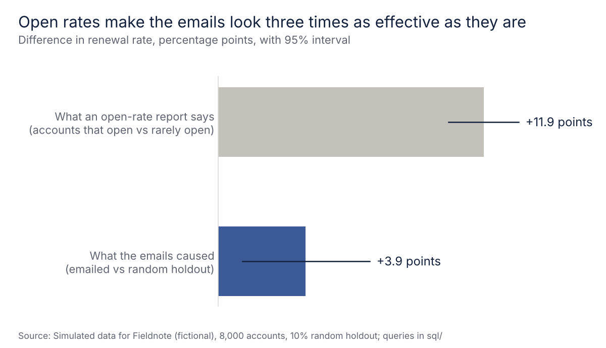
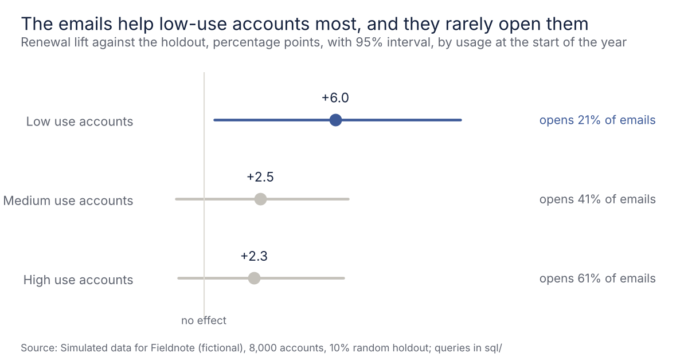

# Customer Value Emails: Do They Keep Customers, and Who Should Get Them?

**In one line:** monthly "here's what you got from us" emails do help customers renew, but only a third as much as open rates suggest. They help most the customers who rarely open them.

Many software companies send customers a monthly email recapping how they used the product. Teams usually judge these emails by how many people open them. I wanted to know what matters more: **do the emails make customers stay?**

To find out, I used a fictional company, Fieldnote (a scheduling app for trades businesses), with 8,000 customers and a year of made-up data. At the start of the year, customers were split at random into three groups: no emails, a monthly recap, or a recap plus one suggested next step. Comparing renewals across the groups shows what the emails themselves caused.

## What I found

- **The emails work.** Customers who got them renewed 3.9 percentage points more often than customers who got none
- **Open rates make them look three times better than they are.** Customers who open a lot were already healthier and more likely to stay
- **The people who rarely open gain the most.** Light users open about 1 in 5 emails, yet the emails lift their renewal by 6 points
- **It's worth about $894K a year** in revenue that would otherwise leave



**How to read it:** the grey bar is what an open-rate report would credit the emails with (+11.9 points). The blue bar is their real effect, measured against customers chosen at random to get no emails (+3.9 points).



## What I'd do

1. Keep the emails, and judge them by renewal instead of opens
2. Keep emailing customers who rarely open; dropping them would give up about $604K a year
3. Always keep a small group who get no emails, so the program can keep proving its worth

## Words used here

- **Renewal lift:** how many more customers renew because of the emails, compared with customers who got none
- **Holdout group:** customers chosen at random to get no emails, so there's a fair comparison
- **ARR (annual recurring revenue):** what customers pay per year

<details>
<summary><b>The full analysis: method, detail and how to run it</b> (for technical readers)</summary>

## The answer

**Keep the emails, stop judging them by open rates, and keep emailing the accounts that rarely open: they gain the most.**

1. **The emails work, but a third as well as open rates suggest.** Accounts that open most emails renew 11.9 points more often than accounts that rarely open. Compared with the random holdout, the emails actually lift renewal by **3.9 points** (95% interval 1.1 to 6.8). The rest of the gap is just healthier accounts opening more email
2. **That is worth about $894K a year in retained ARR** (range $248K to $1.55M), applying the lift to the 90% of the base that would be emailed with a 10% holdout kept running
3. **The accounts that rarely open benefit most.** Low-use accounts open 21% of emails, and 87% of them rarely open, yet their renewal lift is the largest: **+6.0 points** (0.5 to 11.6). A common hygiene rule, "stop emailing accounts that rarely open", would give up an estimated **$604K** of the $894K
4. **The next-step version earns its place with low-use accounts.** Compared with the recap alone, it raised reminders adoption by **8.2 points** for low-use accounts (4.5 to 11.7), and adoption is linked to renewal. For medium and high-use accounts, there was no clear difference
5. **This year's test cannot settle whether the next step also lifts renewal.** The renewal difference between versions (+0.8 points, interval -0.9 to 2.5) is too small to measure. Detecting a 3-point difference for low-use accounts needs 3,484 accounts per version, more low-use accounts than Fieldnote has in a year, so reminders adoption is the measure to watch

## Charts

## Recommendation

| Decision | Detail |
|---|---|
| Keep the program | Worth about $894K a year in retained ARR, well above what a monthly email costs to produce |
| Report the holdout comparison, not open rates | Open rates mostly measure which accounts were already healthy |
| Keep emailing accounts that rarely open | Low-use accounts open least and gain most; cutting them would give up an estimated $604K |
| Send the next-step version to low-use accounts | It lifts reminders adoption by about 8 points for them; either version is fine for everyone else |
| Keep a permanent holdout, and decide its size deliberately | A 10% holdout (819 accounts) measured the lift, but with a wide interval (1.1 to 6.8 points). Detecting a 4-point lift reliably needs about 1,336 accounts per group (17% of the base), which would cost about $70K a year in renewals given up in the larger holdout |

## What would change the answer

- **Unreliable opens:** privacy features in some email apps record opens that never happened, which makes open-rate reporting even less useful and strengthens the case for the holdout
- **Effects that fade:** this is one year. If the lift shrinks as accounts get used to the emails, the prize shrinks with it
- **Large accounts behaving differently:** the prize applies an average lift to ARR. If the lift is concentrated in small accounts, the dollar value is lower than the account-level lift implies
- **The cost of cutting rare openers is a rough guide:** within each usage tier, accounts that rarely open are less healthy than those that open, so their true lift may differ from their tier's average

## How it works

| Step | File | What it does |
|---|---|---|
| 1 | [src/generate_data.py](src/generate_data.py) | Simulates 8,000 accounts, 47,143 monthly sends with opens and clicks, adoption and renewal |
| 2 | [sql/01_account_outcomes.sql](sql/01_account_outcomes.sql) | One row per account with assignment, engagement and outcomes |
| 3 | [sql/02_open_rate_report.sql](sql/02_open_rate_report.sql) | What a typical email report would show |
| 4 | [sql/03_holdout_comparison.sql](sql/03_holdout_comparison.sql) | Renewal and adoption by group and usage tier, counting every assigned account |
| 5 | [sql/04_open_rate_by_tier.sql](sql/04_open_rate_by_tier.sql) | Who opens, and who a "stop emailing rare openers" rule would cut |
| 6 | [src/run_analysis.py](src/run_analysis.py) | Bootstrap confidence intervals, the size of the prize and test sizes |
| 7 | [src/make_charts.py](src/make_charts.py) | The two charts above |

**Method notes**
- Effects are measured on everyone assigned to a group, whether or not they opened anything (intention to treat). That is what the business decides: whether to send, not whether people open
- Confidence intervals come from 4,000 bootstrap resamples
- Test sizes assume 80% power at 5% significance
- Usage tier is set from weekly active seats in the month before the program started, so it cannot be affected by the emails

## Run it

```bash
pip install -r requirements.txt
python src/generate_data.py
python src/run_analysis.py
python src/make_charts.py
```

Results are written to [results/](results/) and charts to [charts/](charts/).

## Limitations

- The data is simulated, so the numbers show how the analysis works rather than how real customers behave. The design (a random holdout, intention to treat, effects by segment) carries over to real data
- Renewal is treated as a single annual event per account; multi-year contracts and mid-term expansions are not modelled
- Cost to produce the emails is not modelled because it is small next to the retained ARR; a real business case would include it

</details>
